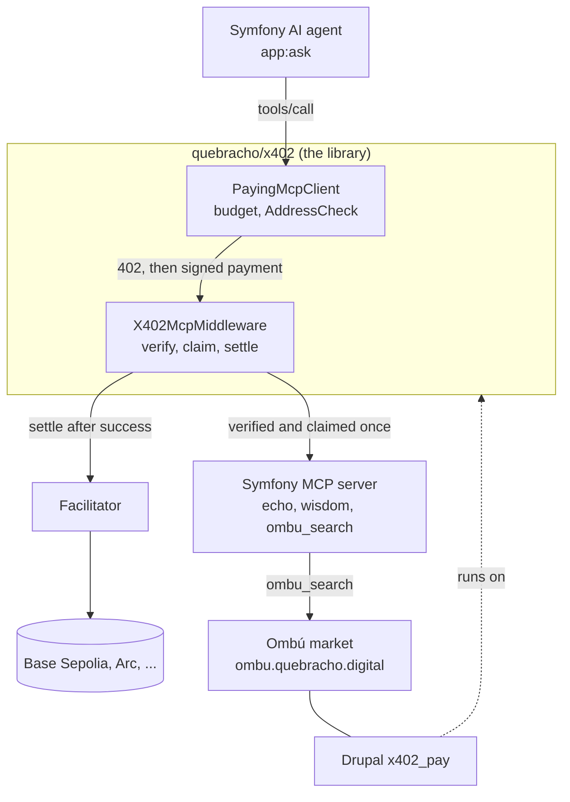

# quebracho/x402

x402 payments for PHP: a framework-free library (PSR-7/14/15/18, MIT) that
lets any PHP service sell, or any PHP agent buy, over
[x402](https://www.x402.org/): HTTP 402 plus a signed USDC authorization. No
API keys, no accounts. The library is [`quebracho/x402`](https://github.com/quebracho-digital/x402) (on Packagist). This repo holds a
Symfony MCP server with a Symfony AI agent (`app/`) that show it working.

Built for the Symfony AI & MCP Hackathon (team Ombu). The version we submitted is
the tag `hackathon-submission`; `main` may move on after it.

What was made for the hackathon: the library and this demo start at commit
[`185d334`](https://github.com/quebracho-digital/quebracho-x402-mcp/commit/185d334)
(2026-10-28), and Ombú's MCP server is
[`f7ef5f0`](https://github.com/quebracho-digital/ombu/commit/f7ef5f0) and
[`f5fd6f0`](https://github.com/quebracho-digital/ombu/commit/f5fd6f0) (2026-11-03). The
signing code was extracted from our own earlier Drupal module x402_pay, and the
Ombú market itself existed before the hackathon. The x402 library is
contributed by Quebracho. It already runs in production on mainnet at
[ombu.quebracho.digital](https://ombu.quebracho.digital), and powers the
Drupal module [x402_pay](https://www.drupal.org/project/x402_pay).

> The demo runs on Base Sepolia. In *mock mode* signatures are real and fully
> verified, but nothing is settled on chain, so you need no wallet and no faucet.

## TL;DR

- **What:** `quebracho/x402`, a framework-free PHP library (MIT) to sell or buy anything over [x402](https://www.x402.org/) (HTTP 402 plus a signed USDC authorization), and a Symfony MCP server whose tools charge per call as its example.
- **Why:** agents can call tools but cannot pay for them. API keys and accounts do not scale to machines.
- **How:** the agent calls a tool, gets a price (402), signs within a budget, retries with the payment, and receives the result with an on-chain receipt.
- **Safe by construction:** verify is not paid. One signature buys one delivery, a replay never runs the handler, smart-wallet signatures are refused, gas is bounded, and addresses are screened. Each defence has a test.
- **Proven:** 474 library tests and 365 app tests with no network, EVM, Solana, NEAR and Casper (both experimental) schemes, a real USDC settle on Base Sepolia, and a real purchase on Arc mainnet through Ombú's MCP server.
- **Used by:** ombu.quebracho.digital, in production on mainnet, and the Drupal module [x402_pay](https://www.drupal.org/project/x402_pay): release 1.0.0-beta3 on drupal.org runs on this library (`quebracho/x402 ^0.3`). The library grew from that module, so one codebase serves Drupal and Symfony.
- **Try it:** `bin/smoke.sh` after `ddev start` (below). Mock mode needs no wallet and no faucet.

## How the pieces fit



The library is the product: the seller middleware and the buyer client are the
two boxes in it. `app/` shows both working with Symfony AI and the PHP MCP SDK.
[Ombú](https://github.com/quebracho-digital/ombu) is a live market of x402
services built on the Drupal module, which runs on the same library. Ombú
also exposes its catalogue as an MCP server, `POST https://ombu.quebracho.digital/mcp`
(Streamable HTTP, no login): `ombu_search_services` and `ombu_get_service` are
free, and `ombu_call_service` is paid with x402 over the MCP transport (Arc).
Code: [f7ef5f0](https://github.com/quebracho-digital/ombu/commit/f7ef5f0) (endpoint
and the two free tools) and [f5fd6f0](https://github.com/quebracho-digital/ombu/commit/f5fd6f0)
(selling listings over MCP).

`app:ask` connects to that Ombú MCP as a second client for search (buying there is disabled by config: Ombú sells on Arc mainnet, and the demo buyer has a Base Sepolia budget and a payee allowlist that leave it out) (`OMBU_MCP_URL`, six lines
of YAML in `config/packages`), next to its own server. The agent therefore has
two ways to search: our faceted `ombu_search` and Ombú's unfiltered
`ombu_search_services`. That is a feature demo (any number of MCP servers, any
facet), not a best practice: in production you would give an agent only the
tools it needs.

## What's inside

| Path | What it is |
|---|---|
| `vendor/quebracho/x402` | [`quebracho/x402`](https://github.com/quebracho-digital/x402): framework-agnostic library (PSR-7/15/17/18, `ext-gmp`), installed by Composer. Signs and verifies x402 payments. |
| `app/` | Symfony 8.1 + `symfony/mcp-bundle`: an MCP server with a free `echo` tool, a free `ombu_search` tool (finds services on [Ombú](https://ombu.quebracho.digital), faceted by the server to Quebracho's own listings, `/market?seller[ours]=ours`; this tool's caller cannot change the facet), a paid `wisdom` tool and a paid `analyze_terms` tool (super beta example, below), and `bin/console app:ask`, a Symfony AI agent that discovers, pays and calls them. |
| `bin/smoke.sh` | End-to-end check over real HTTP: free call, unpaid call (PaymentRequired), paid call (result + receipt). |
| `bin/inspect.py` | Stdlib-only Python MCP client: initialize, `tools/list`, free call, unpaid call (shows the PaymentRequired). No Node needed. |
| `bin/pay.php` | Minimal buyer: turns a PaymentRequired tool result into the same call, paid. |

## Quick start (5 minutes)

Requirements: [DDEV](https://ddev.com/) (PHP runs inside it, nothing to
install on the host) and `curl`.

```bash
git clone https://github.com/quebracho-digital/quebracho-x402-mcp.git
cd quebracho-x402-mcp
ddev start     # the first start also runs composer install for the app
bin/smoke.sh
```

Expected output, abridged:

```
== echo (free)
{"jsonrpc":"2.0","id":3,"result":{"content":[{"type":"text","text":"hello hackathon"}],...}}
== wisdom, unpaid
{"jsonrpc":"2.0","id":2,"result":{"isError":true,"structuredContent":{"x402Version":2,...
== wisdom, paid
{"jsonrpc":"2.0","id":2,"result":{"content":[...],"_meta":{"x402/payment-response":{"success":true,...}}}}
OK
```

That runs in mock mode: real signatures, nothing moves on chain, no funds
needed. To settle for real on Base Sepolia, add to `app/.env.local`:

```bash
X402_FACILITATOR=https://x402.org/facilitator
```

and run `bin/smoke.sh` again: the receipt now carries a transaction hash you can
open on https://sepolia.basescan.org. The example buyer key holds testnet USDC
(anyone can spend it; use your own key from the Circle faucet if it runs dry).
The public facilitator is shared: about one settle in six fails on its side
(`invalid_exact_evm_transaction_failed`, "replacement transaction underpriced"
on its own wallet). Nothing is charged, the output is withheld and the same
payment can be sent again.

The MCP endpoint is `https://quebracho-x402-mcp.ddev.site/mcp` (Streamable
HTTP). Keep the DDEV project name: `allowed_hosts` in
`app/config/packages/mcp.yaml` (DNS rebinding protection) only lists
`localhost` and `quebracho-x402-mcp.ddev.site`, so any other host gets
`403 Invalid Host header`. Add yours there if you rename it. You can also open it in the
[MCP Inspector](https://github.com/modelcontextprotocol/inspector).

The library has its own repository and tests (https://github.com/quebracho-digital/x402); the app's tests run with `ddev exec -d /var/www/html/app vendor/bin/phpunit`.

## The agent: `app:ask`

A Symfony AI agent (`symfony/ai-bundle`) connects to the MCP server as a
client (`mcp.clients.buyer.self` in `app/config/packages/mcp.yaml`), lists its
tools and offers them to the LLM. The PSR-18 client under that MCP connection
is `Quebracho\X402\PayingMcpClient`: when a tool answers with a
PaymentRequired it signs with `X402_BUYER_KEY`, stays within
`X402_BUDGETS` (per network) and `X402_MAX_PER_PAYMENT`, resends the same call with the payment in `_meta` and
reads the receipt.

Point it at any OpenAI-compatible server with tool calling (llama.cpp,
Ollama, ...) in `app/.env.local`:

```bash
LLM_BASE_URL=http://host:8080   # without /v1
LLM_MODEL=your-model
LLM_API_KEY=...
```

```bash
ddev exec -d /var/www/html/app bin/console app:ask "give me a paid piece of engineering advice"
```

```
 Tools on the server: analyze_terms, echo, ombu_search, wisdom
 Paid tool "wisdom": 0.01 USDC (10000 atomic) on eip155:84532 to 0x7e51…6510, settled
 Receipt: {"success":true,"transaction":"","network":"eip155:84532","payer":"0x2c75…5c23"}

Answer
------
Here is a paid piece of engineering advice: "Verify the effect, not the mechanism." ...
```

### `analyze_terms`: read the terms before you accept them (SUPER BETA)

> **Super beta, an example for the hackathon demo. Not legal advice.** A model
> can miss clauses or flag the wrong ones. Read the quotes in the document.

A paid tool (0.02 USDC, `X402_PRICES`) that flags the clauses of a terms of
service or privacy policy, up to 1,200 words, in 19 categories (arbitration,
unilateral changes, data sharing, tracking, auto-renewal...). It shows what an
x402 tool can wrap without any infrastructure of ours: the model is
`deepseek-ai/DeepSeek-V4.1-Flash` (open weights, no reasoning step) on Hugging
Face Inference Providers, called with your `HF_TOKEN`, and the price covers the
call. Change it with `TERMS_MODEL` (`Qwen/Qwen3.8-27B` also works).

Each category comes with quotes the model had to copy exactly, and the server
checks every quote against your text and **drops the ones that are not in it**
(`quotes_dropped` says how many). A reply that is not JSON, or a text that is
too long, is a tool error, so nothing is charged. The categories and the
prompt come from our own curated dataset (below). The text is fenced as data, so a clause that says
"ignore your instructions" is not obeyed.

Answers are memoised for 7 days by a hash of the text, so a repeated text
answers faster, and that speed tells a caller that someone sent the same text
recently. Pass `sensitive: true` to skip the memo (not read, not written) and
the ledger's copy of the answer; it protects your call, not texts others sent
unmarked (a known, accepted risk: DECISIONS.md, D17). Over MCP the only way to ask for no cache is the tool's
`sensitive: true` argument (or a `tool` rule, from `X402_SENSITIVE_TOOLS` or
`app/config/x402_sensitive.yaml`, which also skips the memo): the HTTP headers `Cache-Control: no-store` and
`Pragma: no-cache` are read only on plain HTTP routes (`X402Middleware`), never on `/mcp`, and this app has no
paid plain HTTP route. The rules live in `app/config/x402_sensitive.yaml` (DECISIONS.md, D18).

**The dataset behind it.** The 19 categories are not invented for the demo: they
come from [`quebracho-digital/terminos-es`](https://huggingface.co/datasets/quebracho-digital/terminos-es),
a dataset we curated on Hugging Face (project Lapacho, CC-BY-4.0; gated with
automatic approval). It holds 13 real terms of service and privacy policies in
Spanish (Argentina and the rest of the world: Spotify, Netflix, Google,
Mercado Libre, Mercado Pago, Uber, TikTok, WhatsApp), each labelled with the
clauses a consumer cares about, a **verbatim quote** that justifies every
label and a severity. Eight categories are those of UNFAIR-ToS (LexGLUE), with
the same names so results can be compared, and eleven cover consumer rights and
personal data (indemnification, waiver of rights, tracking...). We found no
Spanish set like it. It was built to measure which models can find those
clauses and **quote** them instead of inventing them: with fixed prompt,
temperature 0 and reasoning off, Qwen3.8-27B reaches F1 0.91 (the best of the five
models we compared reaches 0.92) and the most verbatim quotes, 99%. Limits we state in the
dataset card: the labels were written by a model and corrected by two other
models and one person, so human agreement is not measured; severity is not
evaluated; the full texts are not included (copyright), they are rebuilt from
the URLs and a SHA-256 tells you if the site changed. `analyze_terms` reuses
its categories, its prompt and its rule that a quote must be literal; the
DeepSeek V4.1 Flash it runs by default is not in that comparison.

```bash
ddev exec -d /var/www/html/app bin/console app:ask --hf "Use analyze_terms on this text: <paste up to 1200 words>"
```

**A real run (2026-11-03).** Text: the first 1,100 words of Ombú's own
[terms of use](https://ombu.quebracho.digital/terms.md), with backticks, quotes
and `$` removed so the shell would not touch them. The agent (`openai/gpt-oss-20b`
on Hugging Face) called the tool, paid 0.02 USDC on Base Sepolia and the tool
(DeepSeek V4.1 Flash) answered with every quote verbatim and
`quotes_dropped: 0`. It flagged eight categories, for example:

| Category | Quote from the text |
|---|---|
| contract_by_using | "If you use Ombú through an agent, the person or organisation the agent acts for accepts them and answers for what it does." |
| unilateral_change | "it can change, fail or stop at any time, and these terms may change before it opens for real" |
| choice_of_law | "If you are a consumer under the law that applies to you (in Argentina, Law 24,240), nothing in these terms limits the rights that law gives you and that cannot be waived." |
| cancellation | "You can cancel the purchase of a service sold by Ombú, without giving a reason, within 10 calendar days of it…" |
| limitation_of_liability | "The Operator does not sell, provide, operate, verify, endorse or guarantee these services" |

Runs vary: another run on the same text paid in
`0xe97251dd18e177de16531ad07524b8c1a2437caca262588e9e9f0fa2916e92ac` and the
agent summarised six categories. Not every flagged quote is a clause (one
`content_removal` quote is only the lead-in of a list), which is why it stays
a super beta. The payment is on a testnet, but the Hugging Face call is real.

**Flooding.** A testnet payment costs the caller nothing and each call spends
our Hugging Face credit, so four limits with Symfony's `rate-limiter` (with
`lock`, flock, against parallel requests). Every `POST /mcp` counts against
`MCP_LIMIT_IP` per client per minute (60) and, once within that, against
`MCP_LIMIT_GLOBAL` for the whole server (600 per minute: one /48 holds 65,536
/64 buckets). Both are checked in a `kernel.request` listener
(`App\EventListener\McpRateLimit`, right after routing) before the x402
middleware: a flood reaches no signature check, payee screening or facilitator
`/verify`, and nothing is claimed or charged. A request whose Host or Origin
the transport refuses (403, the bundle's `allowed_hosts`) is not counted and
not throttled: that check is cheap and runs before anything x402 does. Over
a limit the answer is HTTP 429 with a `Retry-After` header (seconds, at least
1, exposed to browsers by `Access-Control-Expose-Headers`) and a JSON-RPC error,
`{"jsonrpc":"2.0","id":<the request's id>,"error":{"code":-32000,"message":"Rate limit reached for /mcp. Nothing was charged; try later."}}`;
the id is `null` for a batch, a notification or a body over 8 KB (not parsed).
Before both, a body over `MCP_MAX_BODY_BYTES` (128 KiB) is refused with HTTP 413
and a JSON-RPC error (`-32600`, id `null`) without being parsed or counted
(`App\EventListener\McpBodyLimit`).
`analyze_terms` then has its own limits inside the tool: `TERMS_LIMIT_IP` calls
per client per hour (5), counted before the payment is read: a paid
`analyze_terms` call over it gets HTTP 429 with `Retry-After`, and nothing is
verified or charged. `TERMS_LIMIT_DAY` (500 per day, in total) is checked by
the tool after the payment is verified and claimed, so a refused call costs
nothing. An empty text, one over 1,200 words or over 12,000 characters is
refused before it uses any limit.

The client is the IP behind `TRUSTED_PROXIES`, an IPv6 address counted by its
/64 (one host usually holds the whole /64). Default `private_ranges`; add Cloudflare's ranges in
production, and never trust `X-Forwarded-For` from anyone else. `private_ranges` trusts any private address as a proxy, so a client that reaches PHP from one (a LAN, a published Docker port) can forge `X-Forwarded-For` and get a new bucket each time; in production list your real proxies instead. Under DDEV alone every caller reaches PHP as the
Docker gateway, so locally **every limit is one bucket shared by everything on the host** (the agent, the smoke test, your browser); a per-client limit needs a real proxy in front
(Cloudflare, nginx) that passes the client IP.

Symfony's `private_ranges` is wider than RFC 1918: besides 10/8, 172.16/12,
192.168/16, loopback and link-local it also holds the TEST-NET ranges
192.0.2.0/24, 198.51.100.0/24 and 203.0.113.0/24, 100.64.0.0/10 (carrier
NAT), 198.18.0.0/15 (benchmarking), 0.0.0.0/8 and 240.0.0.0/4, and for IPv6
::ffff:0:0/96 (every IPv4-mapped address), 2002::/16 (6to4), 2001::/32
(Teredo), 2001:db8::/32 and 64:ff9b::/96 plus 64:ff9b:1::/48 (NAT64; list in
`IpUtils::PRIVATE_SUBNETS`). A proxy that appends a client address from one of those to
`X-Forwarded-For` makes that client look like a trusted hop, so the value the
attacker wrote to its left picks the bucket. In production set
`TRUSTED_PROXIES` to your real proxies, by address.

The global cap trades a flood for a lockout: about
`MCP_LIMIT_GLOBAL / MCP_LIMIT_IP` clients (10 with the defaults) each sending
at their full rate fill it, and then every new client gets 429, even on
`initialize`, until the minute slides. Raise `MCP_LIMIT_GLOBAL` to what your
server can verify per minute; it is a ceiling for a bad day, not a quota.

The limiter state lives in the `cache.rate_limiter` pool (files under
`var/share/<env>/pools/app`, from `APP_SHARE_DIR`, not `var/cache`) and its locks are flock files (`sf.*.lock`) in PHP's
temp directory. Neither is pruned by itself: run
`bin/console cache:pool:prune` from cron (hourly is plenty), and remove lock
files older than a day, for example
`find "$(php -r 'echo sys_get_temp_dir();')" -name 'sf.*.lock' -mtime +1 -delete`.

**Slow tools.** The seller settles after the tool answers, so a signature
must still be valid then. `analyze_terms` offers a 120 s signature
(`X402_TIMEOUTS`, 60 s for every other tool) and declares a worst case of 60 s
from the claim to the settle (`X402_DURATIONS`: 40 s Hugging Face cap plus 20 s
for the settle). A payment with less validity left than that plus 6 s is
refused before the claim with `invalid_exact_evm_payload_authorization_valid_before`:
the same x402 code as an expired signature, here meaning "valid now, but too
short for this tool". Nothing runs or is charged and the buyer signs again. A
tool not in `X402_DURATIONS` is checked exactly as before.

**Job tools are never free.** A tool carrying the flag
`#[PaidJob(role: 'start'|'result', pairedWith: ..., price: ...)]`
(`App\X402\PaidJob`) is always paid, even when `X402_PAID_TOOLS` leaves it
out (fail closed); the flag decides, not the name, so `nosuchtool_start` is
never priced. A `start` tool settles its deposit before running
(`extra.paymentFlow = upfront`), a `result` tool after it delivers. The flag is
published in the tool's `_meta` in `tools/list`
(`"x402/job": {"role": ..., "pairedWith": ...}`). The container build fails
on a tool named `*_start` or `*_result` without the flag, on a flag missing
from `_meta`, on a deposit price that is no positive decimal, on two tools
with one name, and on a pair that does not point back with the other role.
The catalog is read from the tools the MCP bundle actually registered on each
server, so a tool served through a service id the registry (`App\Mcp\` in
`mcp.yaml`) matches counts even when its class lives elsewhere, and the build
fails if a served tool is missing from it. `analyze_terms_start`,
`analyze_terms_result` and the free `analyze_terms_status` (`App\Mcp\AnalyzeTermsJobTool`)
carry it; their jobs live in `app/var/jobs` (`Quebracho\X402\Job\FileJobStore`). The
`_start` offer says in `extra.job` that the deposit is non-refundable and that
`_result` is free when the job fails by our fault.

Before any payment is read, a paid call's arguments are checked against its
tool's input schema, the one the SDK generates and serves in `tools/list`,
with the SDK's own validator (`SchemaValidator`, as `CallToolHandler` uses
it): missing or `null` where not allowed, wrong types, values outside an
enum. A call the tool would refuse is a JSON-RPC `-32602` error, so a `_start`
deposit is never charged for it. What the schema cannot say (a value the tool
itself rejects, for example a text over 1,200 words) still reaches the tool;
on an upfront tool that is after the money moved, so the middleware
dispatches a `failed_after_settle` `PaymentOutcome` (it carries the payment,
so payer and nonce) for a manual refund, and the receipt goes back in
`error.data["x402/payment-response"]`.

A call costs roughly a quarter of a cent at DeepSeek V4.1
Flash's listed prices (our estimate; the Hugging Face bill is not checked yet).

No local LLM? `--hf` runs the same agent on [Hugging Face Inference Providers](https://huggingface.co/docs/inference-providers): put your token in `app/.env.local` and nothing else is needed (the Symfony AI bridge `symfony/ai-hugging-face-platform`).

```bash
echo 'HF_TOKEN=hf_your_token' >> app/.env.local
ddev exec -d /var/www/html/app bin/console app:ask --hf "give me a paid piece of engineering advice"
```

It uses `openai/gpt-oss-20b` (open weights, tool calling; a run costs a few hundred tokens). Any chat model with tool calling works: set `HF_MODEL`.

No LLM at hand? `--tool wisdom` calls the tool directly through the same
paying client. In mock mode `transaction` is empty: nothing moves on chain.

## How a paid call works

x402 travels inside MCP messages, as the official
[MCP transport spec](https://github.com/x402-foundation/x402/blob/main/specs/transports-v2/mcp.md)
defines, so any x402-aware MCP client can pay:

```
agent ──tools/call wisdom──▶ MCP server
      ◀── result: isError + PaymentRequired (price, token, network, payTo)
signs an EIP-3009 transferWithAuthorization for exactly that price
      ──same call + params._meta["x402/payment"]──▶ X402McpMiddleware: verify ▶ run tool ▶ settle
      ◀── tool result + _meta["x402/payment-response"] (receipt)
```

Only `tools/call` of a priced tool is charged: `initialize`, `tools/list` and
free tools pass through. The tool runs only after the payment verifies, and
each payment is claimed once before the tool runs (concurrent replays get `duplicate_settlement`), settlement happens only if the tool succeeded; if settlement fails, the tool
output is withheld. Paid tools cannot be called inside a JSON-RPC batch.

Work that takes minutes (`analyze_terms`) is sold as a job instead: a deposit
settled before the work runs, a free status, and the result paid once it is
ready. [docs/job-mode.md](docs/job-mode.md) has the flow, the states, the
refusals and their cost; `bin/job-demo.sh` runs it against the mock
facilitator.

### Reconciling payments stuck in `settling` or `pending`

A process that dies after the settle went out leaves the payment's state in
`settling` or `pending`: the buyer may have paid and got nothing. Each of those
states is listed in the ledger's open index, and `app:x402:reconcile` corrects
them with what the chain says (the token's `authorizationState`, the
transaction's receipt, or its `AuthorizationUsed` event):

```bash
bin/console app:x402:reconcile            # up to 100 open payments; --limit=N for another number
```

Run it from cron every 5 minutes (it is not set up for you), e.g.
`*/5 * * * * cd /path/to/app && bin/console app:x402:reconcile --limit=100`.
It never charges nor delivers: it marks a charged payment `settled` or frees one
that was never charged, and the buyer's retry then gets the usual answer (an
upfront tool runs once; a default-flow call without a kept answer gets
`already_settled`). Rows marked `needs_review` (a reverted transaction, a used
authorization whose transaction it cannot find, a payment open for more than
24 h) need a person; they and `rpc_error` rows are logged as warnings. It always exits 0. See DECISIONS.md, D20.

### Jobs nobody is looking after (job mode)

A job waits on a request that may be gone: its deposit settled and the process
was killed before the job was queued (`settling`), a `_result` settle ended
ambiguous (`delivering`), a retry queued a job but found no free slot
(`queued`), or a runner died (`running`). `app:jobs:janitor` deals with all of
them, in this order: it moves `settling` and `delivering` jobs on once the
ledger or the chain (the token's `authorizationState`) knows how their payment
ended (`Quebracho\X402\Job\JobReconciler`), runs queued jobs no request ran in a free
slot, fails work untouched for 5 minutes (`failed_ours`, so `_result` is free),
and drops delivered results after their 5-minute re-read window, results nobody
bought after a day (the job then answers `expired`), and the buyer's text on a
`settling` row nobody could resolve for a day.

A buyer never needs a second try to learn its job: every `analyze_terms_start`
answer given once the job row exists carries the `jobId`, refusals included
(`settlement_pending`, `needs_review`, `facilitator_unavailable`, an expired
signature on a late retry), in `structuredContent.jobId`
(`App\X402\JobIdOnRefusal`, only when the deposit's signature recovers to its
payer). The deposit's signature lives 60 s and the reconciler first looks at a
`settling` row after 60 s, so a retry would come too late; the buyer polls
`analyze_terms_status` with the `jobId` instead.
`app:jobs:reconcile` is its first step alone, with a table, for a person.

```cron
# every 5 minutes: the ledger's open payments first (what the job reconciler reads)
*/5 * * * * cd /path/to/quebracho-x402-mcp/app && bin/console app:x402:reconcile --limit=100
# every minute: a queued job waits at most ~1.5 min for a slot, a stuck one is failed after 5
* * * * * cd /path/to/quebracho-x402-mcp/app && bin/console app:jobs:janitor
```

Without the cron, here is exactly what a request does by itself and what stays
stuck. A buyer's `_status` or `_result` call fails its own stale `queued` or
`running` job (`failed_ours`, so `_result` is free) and asks the ledger about
its own `delivering` job. Nothing else moves:

- a `settling` job (the deposit's settle went out and its request died) stays
  `settling` forever, with the buyer's text on disk, even when the deposit was
  paid: only the reconciler queues it or discards it;
- a `delivering` job whose payment the ledger already forgot stays
  `delivering` (a request never asks the chain), so the buyer can neither pay
  again nor read the result;
- a `queued` job that found no free slot is never run; its buyer's next call
  only fails it as ours after 5 minutes, so it gets its result free but no
  analysis;
- nothing is deleted by time: delivered results, results never bought and the
  text of unresolved `settling` rows stay in `app/var/jobs` until the cron runs.

The janitor runs the work in the cron's own PHP process, so that process needs
the web's environment (the model's token, `JOB_SLOTS`).

### Known limits (job mode)

This app is an example to read, for one host, not for production. These are
limits we know and leave in, each also said in a comment where it lives:

- **"Nonce used" is not proof that we were paid** (`Quebracho\X402\Job\JobPayments`).
  When the ledger has forgotten a deposit or a `_result` payment, the cron asks
  the token's `authorizationState(from, nonce)`. An EIP-3009 nonce is the
  payer's: the buyer can burn it with `cancelAuthorization`, or spend it on
  another `transferWithAuthorization` to itself, and the token says "used" all
  the same. A buyer who does that while our settle was ambiguous gets the job
  for the price of a gas fee. The fix is to find the transaction that used the
  nonce (its `AuthorizationUsed` event, as `app:x402:reconcile` does) and check
  that its receipt logs a `Transfer` of the asset from the payer to our `payTo`
  for the price. Not done: the job row keeps neither `payTo` nor the amount, and
  it is a second RPC round trip over a bounded block range.
- **A ledger that loses data can release a paid state.** "No state" is read as
  "never moved" while the state would still be alive. Redis with an eviction
  policy, or restarted without persistence, drops a paid state early: a paid
  deposit's job is then discarded, and a paid `_result` goes back to `ready`
  (the buyer pays twice). Run the ledger's Redis with
  `maxmemory-policy noeviction` and `appendonly yes` (AOF). The DDEV Redis in
  this repo is for development and is not set up that way.
- **The free re-read needs a real payment signature**
  (`App\X402\JobDelivery`). To read a delivered result again within 5 minutes the
  payer signs a valid EIP-3009 authorization for the full price, which we never
  settle. It stays spendable (only to our `payTo`) until it expires, and the
  buyer's budget counts it until then. A stronger and cheaper proof would be an
  EIP-191 signature over the `jobId`.
- **`_status` takes the payer's address, which is public** (`Quebracho\X402\Job\JobStatus`):
  the 128-bit random `jobId` is the real secret there.
- **Buyer text goes to Hugging Face** (`analyze_terms_start` says so): the
  analysis, quotes included, is cached 7 days unless `sensitive`, and the job's
  copy is deleted by the cron at most a day later.

### Address screening

Both sides screen addresses through the library's PSR-14 `AddressCheck`: the
server checks the payer once its signature is verified, the agent checks `payTo`
before it signs. First refusal wins:

1. **OFAC's SDN list**, from OFAC's own Sanctions List Service
   (`Quebracho\X402\OfacSdn`, see [its README](https://github.com/quebracho-digital/x402/blob/main/docs/screening.md)).
   The library asks it before any listener, so nothing in the app can let a
   sanctioned address through, our allowlist included. The app's snapshot is
   `app/var/screening/ofac-sdn.json`; until the first `app:screening sync`, the
   copy shipped with the library is used.
2. **Our allowlist** (`app/var/screening/allow.txt`): skips 3 and 4, nothing else.
3. **Our denylist** (`app/var/screening/deny.txt`): `address_denied`.
4. **Chainalysis' sanctions API** (`Quebracho\X402\ChainalysisApi`), only with
   `X402_SCREENING_API_KEY`. It is asked when the verdict is read (just before
   settling, or signing); answers are cached `X402_SCREENING_CACHE_TTL` seconds,
   and no answer in time follows `X402_SCREENING_UNAVAILABLE` (`allow` lets the
   address pass and logs `ScreeningSkipped`). A 4xx (a wrong key) always rejects.
5. **The token's own blacklist** (`TokenBlacklist`, below).

`App\X402\Screening` holds 2 to 4; the lists are the library's text format
(`AddressList`: one address per line, `#` for comments). A list file that does
not exist is empty; one that cannot be read refuses everyone. Every refusal and
skip is logged by the library's `AddressRejected` and `ScreeningSkipped` events.

OFAC changes without a fixed schedule, so sync it **every day** from cron. The
command replaces the file atomically, keeps it when it already holds a younger
list, and exits non-zero if the download fails, so cron's mail shows it:

`app:x402:check` warns when the list in use is older than 14 days: OFAC publishes
a few times a week, so an older one means the cron stopped.

```cron
# daily, 06:00: OFAC's SDN list into app/var/screening/ofac-sdn.json
0 6 * * * cd /path/to/quebracho-x402-mcp/app && bin/console app:screening sync
```

OFAC no longer publishes an RSS feed; its recent actions reach people by email
(GovDelivery, `USTREAS_61`). Subscribing is a person's job, not the code's.

After those lists, `Quebracho\X402\TokenBlacklist` asks the token itself: Circle
(USDC) and Tether (USDT) freeze addresses in the token contract, OFAC or not,
and a frozen payer or `payTo` makes the settlement revert. It is one `eth_call`
per check (about 200-400 ms) through the network's public RPC, on EVM networks
only; Solana and NEAR are not checked. An RPC that cannot answer follows
`X402_SCREENING_UNAVAILABLE` too, so with the default `reject` an RPC outage
stops payments.

Each token names its own function, and none is guessed. **An asset that is not
in `TokenBlacklist::TOKENS` is not asked** (it passes): add yours with its
`$tokens` argument. Checked on chain with a real `eth_call`:

| Token | Function | Seen |
|---|---|---|
| USDC on Base Sepolia, Arc testnet, Avalanche Fuji | `isBlacklisted` | answers; a made-up selector reverts |
| USDC on Ethereum Sepolia, Polygon Amoy | `isBlacklisted` | unreachable when tried, assumed (Circle's contract) |
| USDC on Ethereum, Base, Polygon, Avalanche, Optimism, Arbitrum, Arc mainnets | `isBlacklisted` | answers; a made-up selector reverts (read from public RPCs, 2026-11-03). Ethereum and Arc are built-in networks, so they are asked as they are; the others are asked once you register the network with `Networks::add()` |
| USDT on Ethereum | `isBlackListed`, `getBlackListStatus` | `true` for 8 of 8 OFAC-listed addresses |
| USDT0 on Arbitrum and Rootstock | `isBlocked` | answers, but `false` for the same 8: never seen to freeze, **not active** |

```bash
ddev exec --dir /var/www/html/app bin/console app:screening sync          # download OFAC's SDN list
ddev exec --dir /var/www/html/app bin/console app:screening deny 0x…      # our own report
ddev exec --dir /var/www/html/app bin/console app:screening allow 0x…     # skip our denylist and the API (never OFAC)
ddev exec --dir /var/www/html/app bin/console app:screening check 0x…
```

## Configuration

`app/.env` holds working defaults. Override them in `app/.env.local` (git-ignored).
Deploy with `APP_ENV=prod` (set in the server's environment or `app/.env.local`):
`app/.env` commits `dev` for development, and a deploy that keeps it shows stack
traces on errors. `app:x402:check` warns when debug is on.

On every deploy, after `composer install`, run `bin/console cache:clear` (not
`cache:warmup`, which can keep the old container) and then
`bin/console app:x402:check`: Pricing, the limiters and the buyer's budget are otherwise only built on the
first request, and the command exits 1 naming each bad value: a name in
`X402_PAID_TOOLS`, `X402_PRICES`, `X402_TIMEOUTS` or `X402_DURATIONS` that is
no tool (a typo there would leave the tool you meant to charge free), a price
that is not a positive amount for any paid tool (`X402_PRICE`, `X402_PRICES`
or a `#[PaidJob]` price), a limit that is not a positive integer, a bad
timeout or duration, an `X402_NETWORK` no scheme supports, a buyer budget that
does not build, a payment ledger that does not take a test claim (Redis, or
`var/x402-ledger`), a bad sensitive rule (`app/config/x402_sensitive.yaml`
malformed or duplicated, or an `X402_SENSITIVE_TOOLS` or `tool` rule name that
is no served tool), an `X402_TIMEOUTS` above `X402_BUYER_MAX_TIMEOUT` (our own
agent would refuse it), and an `X402_PRICES` entry for a tool that is not paid. A typo in a
tool name is reported before the timeout or duration error it causes. An
empty `X402_PAID_TOOLS` is only a warning (every tool free but the
`#[PaidJob]` ones). The same Pricing errors also answer every `/mcp` request
with a 500.

| Variable | Default | Meaning |
|---|---|---|
| `X402_NETWORK` | `eip155:84532` | CAIP-2 network (Base Sepolia). |
| `X402_PRICE` | `0.01` | Price per paid call, in USD. |
| `X402_PAY_TO` | `0x7e51…6510` | Who gets paid. **This is the author's wallet.** Change it to yours. |
| `X402_PAID_TOOLS` | `wisdom,analyze_terms` | Comma-separated tool names that cost money. A `#[PaidJob]` tool is always paid, listed or not. A name here (or in `X402_PRICES`, `X402_TIMEOUTS`, `X402_DURATIONS`) that is no tool is a config error (`app:x402:check` exits 1; `/mcp` answers 500). |
| `X402_SENSITIVE_TOOLS` | empty | Comma-separated tool names whose answers the payment ledger never keeps (only the payment's state): a retry of a settled payment gets `already_settled`, not the answer. A caller can also pass `sensitive: true` to `analyze_terms`, which also skips its memo. See DECISIONS.md, D17. |
| `X402_FACILITATOR` | `mock` | Must be set explicitly: `mock` (verified signatures, nothing settled) or a facilitator URL such as `https://x402.org/facilitator` (real settle: on Base Sepolia by default, on a mainnet when `X402_NETWORK` is one you registered). Anything else fails closed: every `/mcp` request errors, nothing is served for free. |
| `X402_REDIS_URL` | empty | Shared payment ledger, e.g. `redis://redis:6379` (DDEV). Each payment's state (claimed, delivered with its response, pending) lives there, so a retry replays the stored answer on any host. Unset: one host's files in `app/var/x402-ledger`. Set, and Redis down: every paid call fails (500), never a fallback to files, which would deliver one payment once per host. `app:x402:check` pings it. |
| `X402_BUYER_KEY` | web3.js docs key | The agent's buyer key: the public web3.js key, holds testnet USDC; anyone can spend it. For a mainnet use your own key in `.env.local`, never in a committed file. |
| `HF_TOKEN` | empty | Your Hugging Face token, for `app:ask --hf`. Put it in `app/.env.local`. |
| `X402_PRICES` | `{"analyze_terms":"0.02"}` | A tool's own price in USD, when it is not `X402_PRICE`. |
| `X402_TIMEOUTS` | `{"analyze_terms":120}` | A tool's own `maxTimeoutSeconds` (how long its signature lives), when it is not 60: an integer from 1 to 600. A bad value here or in `X402_DURATIONS` does not stop the app from booting: every request to `/mcp` answers 500 (nothing runs, nothing is charged) until it is fixed. `AppKernelTest` checks the committed `.env`. |
| `X402_DURATIONS` | `{"analyze_terms":60}` | A tool's worst case in seconds from the claim to the settle; a payment with less validity left (plus 6 s) is refused before the claim. Must stay under the tool's timeout minus 6 s. A tool not listed: no check. |
| `TERMS_MODEL` | `deepseek-ai/DeepSeek-V4.1-Flash` | The model behind `analyze_terms` (super beta): open weights on Inference Providers; needs `HF_TOKEN`. |
| `MCP_LIMIT_IP` | `60` | `POST /mcp` requests per client per minute (an IPv6 client by its /64), refused with 429 before any payment is checked. |
| `MCP_LIMIT_GLOBAL` | `600` | `POST /mcp` requests per minute for the whole server, counted only for clients within their own limit. |
| `MCP_MAX_BODY_BYTES` | `131072` | Largest `POST /mcp` body, in bytes; a larger one gets 413 before anything parses it. Holds the longest `analyze_terms` text, fully escaped, plus its payment. |
| `TERMS_LIMIT_IP` / `TERMS_LIMIT_DAY` | `5` / `500` | `analyze_terms` paid calls per client per hour (HTTP 429, before the payment is read) and in total per day (a tool error, after the payment is claimed); nothing is charged in either case. |
| `HF_MODEL` | `openai/gpt-oss-20b` | The model `--hf` uses: any chat model on Inference Providers with tool calling. |
| `X402_BUDGETS` | `{"eip155:84532":"0.05"}` | The agent's spending cap per run, in USD, JSON by network. A network not listed is never paid (Arc mainnet is left out on purpose: add it in `.env.local` with a non-public key). |
| `X402_MAX_PER_PAYMENT` | `{"eip155:84532":"0.02"}` | Ceiling for one single payment, same shape. |
| `X402_BUYER_MAX_TIMEOUT` | `170` | The longest validity (seconds) the agent signs. Under the 180 s its HTTP client waits, so it never signs a payment that can be settled after it hung up. |
| `X402_PAYTO_ALLOW` | the demo `PAY_TO` | Wallets the agent may pay, comma separated, default deny: a seller cannot name its own wallet. |
| `X402_SCREENING_API_KEY` | empty | Chainalysis sanctions API key. Empty: OFAC's list, ours and the token's. |
| `X402_SCREENING_CACHE_TTL` | `86400` | Seconds an API answer (clean or sanctioned) is kept. |
| `X402_SCREENING_TIMEOUT` | `3` | Seconds to wait for the API. |
| `X402_SCREENING_UNAVAILABLE` | `reject` | No API answer in time (or a 5xx, or a reply without `identifications`): `reject` or `allow`. |
| `MCP_URL` | the DDEV site's `/mcp` | The MCP server the agent connects to. |
| `OMBU_MCP_URL` | `https://ombu.quebracho.digital/mcp` | Ombú's MCP server, the agent's second client (search only, see above). |
| `LLM_BASE_URL`, `LLM_MODEL`, `LLM_API_KEY` | placeholders | The agent's OpenAI-compatible LLM; set them in `.env.local`. |

**Payment logs.** The library's `PaymentLog` logs every event it reports: an
`intent` line before each settle or upfront tool run, an `outcome` line per
paid call, a `fault` when the ledger failed and the sale went on (`record` is
an error: money may have moved and its state was lost), each address the
screening refused or could not check, and the buyer's purchases and budget
reclaims (never the signature, the response body or a token). With `symfony/monolog-bundle`
installed (a `require-dev` here) it uses the `x402` Monolog channel; without
it (`composer install --no-dev`) it writes to `php://stderr` at level `info`
(`app.x402_stderr_logger` in `app/config/services.yaml`), prefixed `x402 `.

**Payment records.** Logs can be lost (PHP-FPM may drop stderr), so
`Quebracho\X402\PaymentRecord` also keeps the payments that moved money or should
have: one JSON line per `settled`, `delivered`, `not_settled` or
`failed_after_settle` outcome, appended to `app/var/x402-records/<YYYY-MM>.jsonl`
(time, status, settlement key, network, `payTo`, amount, asset, payer,
transaction, reason; never the signature). Refusals charged nothing and stay
in the log only. Nothing rotates or deletes these files. A `failed_after_settle`
line is a refund to make by hand.

## Using the library

**Seller (MCP)**: `X402McpMiddleware` charges tool calls in band; `$price`
gets the `tools/call` params. **Seller (plain HTTP)**: `X402Middleware` answers
402 with `PAYMENT-REQUIRED`, for any endpoint:

```php
use Quebracho\X402\{EvmExact, FileClaims, Networks, X402Middleware};

$price = fn ($request) => [Networks::requirements('eip155:84532', '0.01', $payTo)]; // or null = free
$middleware = new X402Middleware([new EvmExact()], $price, $claim, $psr17, $psr17, $settle);
// $settle: a facilitator callback, or Settlement::mock() (nothing moves on chain).
```

**Buyer (MCP)**: `PayingMcpClient` wraps the PSR-18 client of an MCP HTTP
transport and pays tools in band; same arguments as below plus a PSR-17 stream
factory. **Buyer (plain HTTP)**: wrap any PSR-18 client; it pays 402s within a budget:

```php
use Quebracho\X402\{Budget, EvmExact, PayingHttpClient, Signer};

$client = new PayingHttpClient(
    $anyPsr18Client,
    [new EvmExact(new Signer($testnetKey))],
    Budget::usd('eip155:84532', '0.05'),   // never spends more than 5 cents
);
```

**Networks**: built in are the demo testnets (Base Sepolia, Arc testnet, Ethereum Sepolia, Avalanche Fuji, Polygon Amoy, Solana devnet), Arc mainnet (`eip155:5042`, where Ombú sells), and Ethereum mainnet, which is there to be read (the blacklist of its USDC and USDT: an `eth_call`, no gas). Any other EVM chain, mainnets included, whose token implements EIP-3009, is added with `Networks::add()`. The steps, the contract and the blacklist function to use are in [Add a blockchain](https://github.com/quebracho-digital/x402/blob/main/docs/networks.md):

```php
$network = Networks::add(chainId: 4202, asset: '0x…', name: 'USDC', version: '2');
```

**Other chain families** implement the `Scheme` interface (`supports`,
`pay`, `verify`, `payer`), shaped after the x402 spec rather than after EVM. `NearExact`
(`near:testnet`, NEP-366 delegate action, `ext-sodium`) is **experimental**:
its `verify()` does not tie the public key to `sender_id` (the network checks
that on settle), and it is not wired into the demo. `SolanaExact`
(`solana:*`) pays and verifies offline; see the library README. `CasperExact` (`casper:*`, a CEP-18 authorization signed as Casper EIP-712, Ed25519 keys) is **experimental**: verified offline against the reference client's vectors, not yet settled live, and not wired into the demo; see [docs/casper.md](https://github.com/quebracho-digital/x402/blob/main/docs/casper.md).

## Attacks it resists

Each line is a test that fails if the defence breaks (the library's `tests`,
`app/tests`). Most come from reviewing this code against the x402 v2 spec;
the reasons are in [DECISIONS.md](DECISIONS.md).

**Seller side**
- **One signature, many deliveries.** Each payment is claimed once (network,
  payer, nonce) before the tool runs; copies get `duplicate_settlement` (D5;
  20 concurrent copies were checked by hand, one delivery).
  `X402McpMiddlewareTest::testAPaymentBuysOneDeliveryEvenUnsettled`.
- **Malleated signatures**: high-s rejected (EIP-2). `EvmExactTest::testRejectsAMalleatedHighSSignature`.
- **Malformed payloads** get a rejection, never a 5xx. `EvmExactTest` (`tampered`).
- **Paid output without payment**: settlement only after the tool succeeded, and
  a failed or odd facilitator answer withholds the output.
  `X402McpMiddlewareTest::testABrokenFacilitatorWithholdsTheOutput`.
- **Long-lived signatures**: `validBefore` capped by the offer's timeout. `EvmExactTest::testRejectsAValidityWindowLongerThanTheOffer`.
- **Paid calls inside a JSON-RPC batch**: refused (D3). `X402McpMiddlewareTest::testBatchWithAPaidCallIsRejected`.

**Buyer side**
- **A hostile 402**: the agent signs only known tokens and EIP-712 domains,
  positive integer amounts within its cap, a canonical `payTo` (`0x` + 40 hex;
  a padded one would sign to an address screening never saw), and short
  validity. `BudgetTest::testRefusesAHostileOffer`.
- **A seller that never confirms** cannot drain past the cap: the budget is spent
  at signing, and given back only when the chain says the nonce was never used,
  60 s after expiry (D6, D8). `PayingMcpClientTest`, `BudgetTest`.

**Both sides**
- **Sanctioned or reported addresses**: payer and `payTo` screened (D7); a list
  or API that cannot answer fails closed. `app/tests/X402/ScreeningTest`.

### Compared with the official SDK

Checked against `x402-foundation/x402` (TypeScript and Go, October 2026):

- **A replay never runs the tool.** The official middlewares run the handler,
  then settle, and drop the output if the chain rejects the spent nonce: every
  replayed copy still costs the seller the tool's compute and side effects.
  Here the payment is claimed before the handler, so a copy is refused before
  any work is done (D5).
- **The buyer has a spending cap.** The official clients have none. Here a
  payment with no successful receipt stays spent until `authorizationState`
  says the nonce was never used, never on the seller's word (D6, D8).
- **Address screening**, for payer and `payTo`, failing closed. The official
  SDK has none (D7).

## Status

Working and verified:
- EIP-712 / EIP-3009 signing, checked against the EIP-712 spec vectors; offline `ecrecover`.
- PSR-15 middlewares: x402 over MCP (in band) and over plain HTTP (402); offline verification, settle-after-success.
- Verification aligned with the reference facilitator: spec §9 reason codes, low-s signatures only, 6 s expiry slack.
- PSR-18 paying clients with a per-network spending cap: MCP in band (`PayingMcpClient`) and plain HTTP 402 (`PayingHttpClient`).
- Symfony MCP server charging a tool end to end (`bin/smoke.sh`).
- Symfony AI agent (`app:ask`) that discovers, pays and calls the tool, verified against a local llama.cpp model (mock mode).
- Address screening on both sides (PSR-14 `AddressCheck`): OFAC's SDN list first, then our allow/deny lists, the optional Chainalysis API and the token's own blacklist.
- Settlement on testnet through a facilitator (`X402_FACILITATOR=https://x402.org/facilitator`, verified on Base Sepolia).

Not yet:
- Unverified: the EIP-712 domains of USDC on Ethereum Sepolia, Avalanche Fuji and Polygon Amoy (confirmed by the first testnet payment on each).

Found on the way, reported upstream: the MCP bundle's HTTP controller cannot take an application
middleware (`MiddlewareFactory` is `final` and the stack is fixed), so the app copies the controller
(`app/src/Controller/McpController.php`) and must follow bundle changes by hand. Issue
[symfony/ai#2883](https://github.com/symfony/ai/issues/2883) proposes an extension point.

Plan, open tasks and what comes after the hackathon: [ROADMAP.md](ROADMAP.md).

## License

MIT, see [LICENSE](LICENSE). Some library classes were first written by the
same author for the `x402_pay` Drupal module and are relicensed here; see
[NOTICE](https://github.com/quebracho-digital/x402/blob/main/NOTICE).
