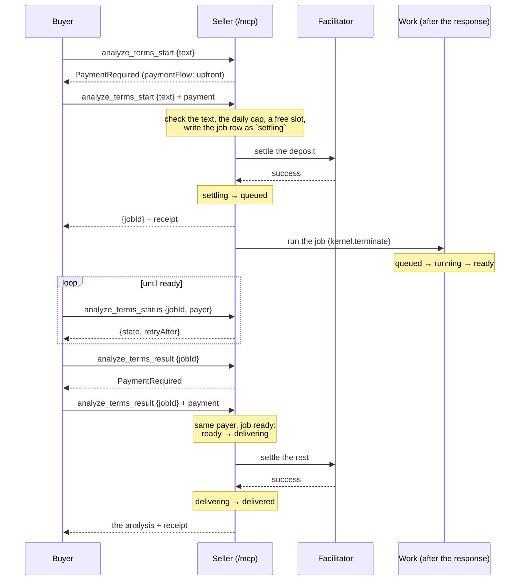

# Job mode: paying for work that takes a while

x402 settles one payment per call: the buyer signs, the tool answers, the
seller settles. That fits an answer that comes back in a second. It does not
fit work that takes minutes: the buyer's HTTP request would have to stay open
the whole time, and the signature would expire before the seller could settle
it.

Job mode splits such a tool into three MCP tools and two payments. The example
in this repo is `analyze_terms`, which calls a model on Hugging Face:

| Tool | Paid | When the money moves |
|---|---|---|
| `analyze_terms_start` | yes, a deposit (0.01 USDC) | **before** the tool runs (`extra.paymentFlow: "upfront"`); not refunded |
| `analyze_terms_status` | no | |
| `analyze_terms_result` | yes, the rest (0.01 USDC) | **after** the tool answered, as for any x402 call |

The buyer starts the job, polls its status, and buys the result once it is
ready. If the job fails by our fault, the result is refused **without
charging**, so the buyer loses the deposit only.

The job engine is in the library (`quebracho/x402` since v0.4.0): the `Job`
states, the job store (`FileJobStore`), the runner, the reconciler and the
janitor live in `Quebracho\X402\Job`. The paid-tool wiring is this app's:
`X402McpMiddleware` takes hooks (`validate`, `payer`, `settle`, `sensitive`),
and the app plugs job mode into them. A tool declares its role with
`#[PaidJob('start' | 'result', pairedWith: ...)]` (`App\X402\PaidJob`).

## The flow



### Where it lives in the code

| Class | Does |
|---|---|
| `Quebracho\X402\Job\JobDesk` | routes the middleware's hooks by the tool's role |
| `Quebracho\X402\Job\JobDeposit` | the `_start`: checks, slot, the `settling` row before the settle, queue, the run after the response, the `jobId` on a refusal |
| `Quebracho\X402\Job\JobDelivery` | the `_result` and the `_status`: who may buy, ready → delivering, the state after the settle, the free re-read |
| `Quebracho\X402\Job\Job` | the job and its states (below) |
| `Quebracho\X402\Job\JobRunner`, `App\Terms\AnalyzeTermsWork` | the work, run after the response in the slot the deposit took |
| `Quebracho\X402\Job\JobReconciler`, `Quebracho\X402\Job\JobJanitor` | the cron: moves on jobs whose request is gone |
| `Quebracho\X402\Job\JobIdOnRefusal` | adds the `jobId` to any `_start` refusal given once the job exists |

## States

```
settling ─> queued ─> running ─> ready ─> delivering ─> delivered
              │          │                    │
              └──────────┴─> failed_ours      └─> ready (the `_result` payment did not settle)
```

| State | Means | What the buyer does |
|---|---|---|
| `settling` | the job row was written, the deposit is being settled | poll `_status` (every 10 s) |
| `queued` | the deposit is ours; the work waits for a slot | poll (5 s) |
| `running` | the work is running | poll (5 s) |
| `ready` | the result is there, for one day | buy it with `_result` |
| `delivering` | a `_result` payment is being settled | poll (10 s); a second payment is refused |
| `delivered` | paid; for 5 minutes the payer may read it again for free | nothing |
| `failed_ours` | our failure: `provider_error`, `invalid_reply`, `our_timeout` or `our_daily_cap` | `_result` is refused, nothing is charged |
| `expired` | ready, but nobody bought it within a day: deleted | nothing |
| `unknown` | no such job, **or another payer's job** (the same answer, on purpose) | check the `jobId` and the payer |

`settling` exists so that a crash between "the deposit settled" and "the job
is queued" leaves a row behind. The row is keyed by the deposit's settlement
key, so the reconciler can ask how the payment ended. A job is never written
after the money moved without that trace.

## Refusals, and what they cost

Every refusal below happens before any money moves. The buyer is charged
nothing.

| When | Reason | Why |
|---|---|---|
| `_start`, before the payment is read | JSON-RPC `-32602` | the text is too long, or the tool does not exist |
| `_start` | `our_daily_cap` | our model budget for the day is spent |
| `_start` | `job_slots_busy` | every slot is taken (`JOB_SLOTS`); retry the same payment |
| `_start` | `job_slots_unavailable`, `jobs_unavailable` | the lock store or the job store did not answer |
| `_result` | `unknown_job` | no such job, or not yours |
| `_result` | `job_not_ready` | still `settling`, `queued` or `running` |
| `_result` | `result_pending` | another `_result` payment is being settled |
| `_result` | `job_failed_ours` | the job failed by our fault: nothing to sell, nothing charged |
| `_result` | `job_expired` | nobody bought it within a day |
| `_result` | `already_delivered` | paid, and the 5-minute re-read window is over |

Two rules keep a buyer from paying twice:

- **The same deposit gets the same job.** A retry of a `_start` with the same
  payment answers the same `jobId`, whatever state the job reached.
- **A refusal after the job exists carries the `jobId`** in
  `structuredContent.jobId` (`settlement_pending`, `needs_review`,
  `facilitator_unavailable`, an expired signature on a late retry). The
  deposit's signature lives 60 s and the reconciler looks at a `settling` row
  after 60 s, so a retry would come too late; the buyer polls `_status` with
  the `jobId` instead. Only the deposit's payer gets it: its signature must
  recover to its `from`.

## Jobs nobody looks after

A job can outlive its request: the process died after the deposit settled, a
`_result` settle ended with no answer, a queued job found no free slot. The
cron moves them on (`app:x402:reconcile` every 5 minutes, then
`app:jobs:janitor` every minute). The README's "Jobs nobody is looking after"
lists what stays stuck without the cron.

## Known limits

This app is an example for one host, not for production. These limits are
known and left in; the README's "Known limits (job mode)" has the detail.

1. **"Nonce used" is not proof of payment.** When the ledger forgot a payment,
   the cron asks the token's `authorizationState`. The buyer can burn its own
   nonce (`cancelAuthorization`) and the token says "used" all the same. The fix
   is to check the transaction's `Transfer` to our `payTo`.
2. **A ledger that loses data can release a paid state.** Run the ledger's
   Redis with `maxmemory-policy noeviction` and `appendonly yes`.
3. **The free re-read needs a real payment signature**, valid and never
   settled, which stays spendable (only to our `payTo`) until it expires. An
   EIP-191 signature over the `jobId` would be a cheaper proof.

## Try it

`bin/job-demo.sh` runs the whole flow against the DDEV site with the mock
facilitator: nothing moves on chain. It calls the model once (Hugging Face,
`HF_TOKEN`); a repeated text is answered from the 7-day memo.

```bash
bin/job-demo.sh
```
